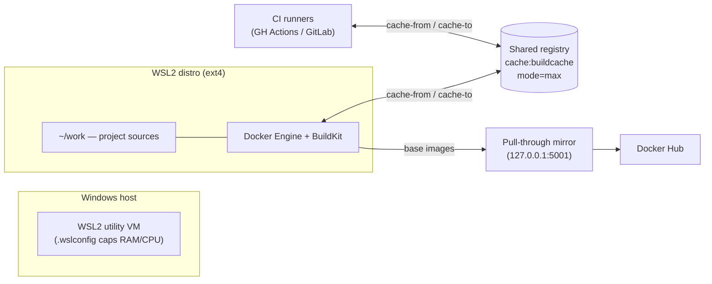

# stoke

> Lightweight local container setup for Windows: **Docker Engine inside WSL2** (no Docker Desktop) plus a **shared BuildKit layer cache** that your local builds and CI builds both use.

Türkçe README: [README.tr.md](README.tr.md)

[](LICENSE)
[](https://github.com/kefyusuf/stoke/actions/workflows/ci.yml)
[](https://scorecard.dev/viewer/?uri=github.com/kefyusuf/stoke)

> ⚠️ **Review before running.** These scripts make system-level changes (Windows
> features, apt/systemd inside WSL, root-owned files). The intended workflow is
> read-then-run — [SECURITY.md](SECURITY.md) lists exactly what each script touches.
> Safety net built in: every script has `--dry-run` (preview, changes nothing),
> shows its plan and asks `[y/N]` before the first change, and
> `setup/teardown.sh` reverses the whole kit when you want out.

## Why

| Problem | This kit |
|---|---|
| Docker Desktop idles at ~2–3 GB RAM and keeps waking the CPU | Run plain Docker Engine inside WSL2 — community measurements show roughly **half the resource usage**, and `.wslconfig` gives you an official hard cap on the VM |
| Builds from `/mnt/c` are ~5× slower (9P filesystem boundary) | Keep sources in the WSL2 ext4 filesystem — nearly native Linux I/O |
| CI starts from a cold cache on every run | One BuildKit cache ref (`type=registry, mode=max`) shared by local and CI: **whoever builds first warms it for everyone** |
| Base images re-downloaded on every machine | Optional pull-through registry mirror caches Docker Hub locally |
| Docker Desktop needs a paid license at 250+ employees or $10M+ revenue | Docker Engine is Apache-2.0 — nothing to license |

Full claim-by-claim citations: [docs/evidence.md](docs/evidence.md)

## Proof, captured

<details>
<summary>Real output from a verify.sh run (WSL engine, 2026-11-04)</summary>

```text
  PASS  warm build: 1308 ms
  PASS  layer cache speedup: 7x (warm < cold)
  PASS  builder A exported cache to the registry (mode=max)
  PASS  builder B (fresh, empty store) hit CACHED layers via --cache-from registry
  PASS  => cross-machine cache reuse (local <-> CI) works on this machine

  ALL CHECKS PASSED - this machine is cache-ready.
```
</details>

<details>
<summary>All three templates, built and smoke-tested (prod containers over HTTP)</summary>

```text
--- node-ts prod: {"ok":true,"stack":"node-ts","time":"2026-11-04T16:54:16.714Z"}
--- rust  prod:   {"ok":true,"stack":"rust","epoch":1793812091}
--- go    prod:   {"ok":true,"stack":"go","time":"2026-11-04T17:08:23Z"}
```
</details>

## Architecture



Local build → pushes cache to the shared ref. CI pulls that ref as its warm cache — and pushes its own updates back. The mirror keeps base images to one download for the whole team.

## Quickstart

Prerequisites: Windows 10 21H2+ or Windows 11, admin PowerShell, ~10 GB disk.

1. **Windows side** (admin PowerShell, from the repo root):
   ```powershell
   ./setup/setup-wsl.ps1            # installs WSL2 + Ubuntu, writes .wslconfig, restarts WSL
   ```
   If script execution is blocked by policy:
   `powershell -ExecutionPolicy Bypass -File setup\setup-wsl.ps1`.
2. **Inside WSL** (open a terminal in your distro):
   ```bash
   mkdir -p ~/work && cd ~/work                        # ext4, NOT /mnt/c
   git clone <this-repo> && cd stoke
   ./setup/setup-engine.sh                             # docker-ce + buildx + compose plugin
   # shows its plan and asks [y/N] first (--dry-run previews, --yes skips the prompt);
   # log out and back in (or run `newgrp docker`) so the docker group applies
   ```
3. **Optional shared cache registry** (local, HTTP-free setup — 127.0.0.0/8 is insecure-by-default):
   ```bash
   docker compose -f cache-stack/docker-compose.registry.yml up -d
   ```
4. **Build with cache**: scaffold a project in one command (copies the stack template,
   build wrappers and a project-scoped `.env`):
   ```bash
   ./setup/init-project.sh rust myapp    # stacks: rust | go | node-ts
   cd myapp && ./build.sh                # CACHE_REF already in .env
   ```
   or copy `templates/Dockerfile` + `templates/build.sh` manually.
5. **Prove it works**:
   ```bash
   ./setup/verify.sh      # checks the toolchain, times cold vs cached build, tests the registry cache round-trip
   ```
6. **Want out later?** The kit undoes itself:
   ```bash
   ./setup/teardown.sh --dry-run   # preview the reversal, change nothing
   ./setup/teardown.sh             # containers -> context -> services -> group -> packages -> repo files
   ```
   `/var/lib/docker` and `.wslconfig` are only touched with explicit
   `--purge-data` / `--restore-wslconfig`.

For CI, wire the same `CACHE_REF` into your pipeline — ready-made templates are in [`ci/`](ci/).

## Daily driver

| Command | What it does |
|---|---|
| `./setup/doctor.sh` | One-pass read-only health report: daemon, buildx, context, systemd, Desktop CLI shadowing, cache stack, mirror registration, disk |
| `./setup/init-project.sh <stack> <name>` | Scaffold a project: stack template + cache wrappers + project-scoped `.env` (`rust \| go \| node-ts`) |
| `./setup/windows-context.ps1` | Bridge the engine to Windows tools (PowerShell CLI, VS Code Docker panel); `-Undo` reverses |
| `./setup/verify.sh` | Benchmark: cold vs cached build + registry cache round trip |
| `./setup/protect-distro.sh check` | Who owns the CLI/socket when Docker Desktop coexists |
| `./setup/teardown.sh --dry-run` | Preview the full uninstall; run without the flag to apply |

> **Keeping Docker Desktop?** You don't have to uninstall it. Installed-but-idle or
> fully-parallel both work — checklist, port rules and rollback in
> [docs/migration.md](docs/migration.md).

## Repo map

| Path | Purpose |
|---|---|
| `setup/setup-wsl.ps1` | Windows-side bootstrap: WSL2, distro, `.wslconfig` |
| `setup/.wslconfig.template` | Annotated memory/CPU/swap limits |
| `setup/setup-engine.sh` | WSL-side Docker Engine + buildx + compose install |
| `setup/setup-nerdctl.sh` | Optional lighter variant: containerd + nerdctl |
| `setup/verify.sh` | Smoke test + cache benchmark (first vs second build) |
| `setup/doctor.sh` | Daily read-only health report (FAIL/WARN/INFO lines) |
| `setup/init-project.sh` | Project scaffolder: stack template + wrappers + project-scoped `.env` |
| `setup/windows-context.ps1` | Windows-side docker access to the kit engine (loopback TCP + context, `-Undo` included) |
| `setup/teardown.sh` | Reverses every kit mutation in safe order (data/config deletes strictly opt-in) |
| `cache-stack/` | Local cache registry + pull-through mirror (compose) |
| `templates/` | Generic multi-stage Dockerfile + cache-aware build wrappers |
| `templates/node-ts/` | Runnable Node/TS sample: prod + dev targets, pnpm store cache mounts, compose dev server |
| `templates/rust/` | Runnable Rust sample: dummy-crate deps stage, cargo cache mounts, musl static binary |
| `templates/go/` | Runnable Go sample: GOMODCACHE/GOCACHE mounts, `scratch` prod image |
| `ci/` | GitHub Actions (registry & gha cache) and GitLab CI templates |
| `tests/` | Zero-dependency unit suite for the scripts' guard/dry-run/consent/teardown contracts (runs in CI) |
| `docs/` | Evidence, deep-dive guides, FAQ |

## Documentation

- [docs/evidence.md](docs/evidence.md) — every claim with sources ([TR](docs/evidence.tr.md))
- [docs/setup-wsl2.md](docs/setup-wsl2.md) — manual WSL2 + Engine walkthrough ([TR](docs/setup-wsl2.tr.md))
- [docs/cache-guide.md](docs/cache-guide.md) — BuildKit cache backends, `mode=max`, cache mounts ([TR](docs/cache-guide.tr.md))
- [docs/registry-mirror.md](docs/registry-mirror.md) — pull-through mirror setup and its limits ([TR](docs/registry-mirror.tr.md))
- [docs/nerdctl-variant.md](docs/nerdctl-variant.md) — containerd + nerdctl alternative path ([TR](docs/nerdctl-variant.tr.md))
- [docs/migration.md](docs/migration.md) — Docker Desktop ile bir arada yaşama: kurulu-ama-kapalı veya tam paralel ([TR](docs/migration.tr.md))
- [docs/faq.md](docs/faq.md) — troubleshooting (VMMEM, permissions, cache misses…) ([TR](docs/faq.tr.md))

## Requirements

- Windows 10 21H2+ / Windows 11 with virtualization enabled
- ~10 GB free disk for the distro + images
- A Docker registry reachable by both your machine and CI (GHCR, GitLab registry, or the included local one for testing)

## License

MIT — see [LICENSE](LICENSE).
