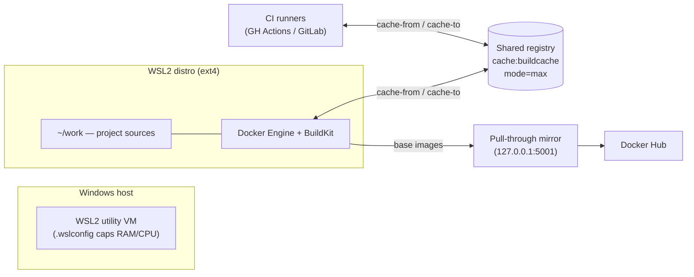

# wsl2-docker-cache-kit

> Lightweight local container setup for Windows: **Docker Engine inside WSL2** (no Docker Desktop) plus a **shared BuildKit layer cache** that your local builds and CI builds both use.

Türkçe README: [README.tr.md](README.tr.md)

## Why

| Problem | This kit |
|---|---|
| Docker Desktop idles at ~2–3 GB RAM and keeps waking the CPU | Run plain Docker Engine inside WSL2 — community measurements show roughly **half the resource usage**, and `.wslconfig` gives you an official hard cap on the VM |
| Builds from `/mnt/c` are ~5× slower (9P filesystem boundary) | Keep sources in the WSL2 ext4 filesystem — nearly native Linux I/O |
| CI starts from a cold cache on every run | One BuildKit cache ref (`type=registry, mode=max`) shared by local and CI: **whoever builds first warms it for everyone** |
| Base images re-downloaded on every machine | Optional pull-through registry mirror caches Docker Hub locally |
| Docker Desktop needs a paid license at 250+ employees or $10M+ revenue | Docker Engine is Apache-2.0 — nothing to license |

Full claim-by-claim citations: [docs/evidence.md](docs/evidence.md)

## Architecture



Local build → pushes cache to the shared ref. CI pulls that ref as its warm cache — and pushes its own updates back. The mirror keeps base images to one download for the whole team.

## Quickstart

Prerequisites: Windows 10 21H2+ or Windows 11, admin PowerShell, ~10 GB disk.

1. **Windows side** (admin PowerShell, from the repo root):
   ```powershell
   ./setup/setup-wsl.ps1            # installs WSL2 + Ubuntu, writes .wslconfig, restarts WSL
   ```
   If script execution is blocked by policy:
   `powershell -ExecutionPolicy Bypass -File setup\setup-wsl.ps1`.
2. **Inside WSL** (open a terminal in your distro):
   ```bash
   mkdir -p ~/work && cd ~/work                        # ext4, NOT /mnt/c
   git clone <this-repo> && cd wsl2-docker-cache-kit
   ./setup/setup-engine.sh                             # docker-ce + buildx + compose plugin
   # log out and back in (or run `newgrp docker`) so the docker group applies
   ```
3. **Optional shared cache registry** (local, HTTP-free setup — 127.0.0.0/8 is insecure-by-default):
   ```bash
   docker compose -f cache-stack/docker-compose.registry.yml up -d
   ```
4. **Build with cache**: copy `templates/Dockerfile` and `templates/build.sh` into your project, then:
   ```bash
   CACHE_REF=127.0.0.1:5000/myapp:buildcache ./build.sh
   ```
5. **Prove it works**:
   ```bash
   ./setup/verify.sh      # checks the toolchain, times cold vs cached build, tests the registry cache round-trip
   ```

For CI, wire the same `CACHE_REF` into your pipeline — ready-made templates are in [`ci/`](ci/).

## Repo map

| Path | Purpose |
|---|---|
| `setup/setup-wsl.ps1` | Windows-side bootstrap: WSL2, distro, `.wslconfig` |
| `setup/.wslconfig.template` | Annotated memory/CPU/swap limits |
| `setup/setup-engine.sh` | WSL-side Docker Engine + buildx + compose install |
| `setup/setup-nerdctl.sh` | Optional lighter variant: containerd + nerdctl |
| `setup/verify.sh` | Smoke test + cache benchmark (first vs second build) |
| `cache-stack/` | Local cache registry + pull-through mirror (compose) |
| `templates/` | Generic multi-stage Dockerfile + cache-aware build wrappers |
| `templates/node-ts/` | Runnable Node/TS sample: prod + dev targets, pnpm store cache mounts, compose dev server |
| `templates/rust/` | Runnable Rust sample: dummy-crate deps stage, cargo cache mounts, musl static binary |
| `templates/go/` | Runnable Go sample: GOMODCACHE/GOCACHE mounts, `scratch` prod image |
| `ci/` | GitHub Actions (registry & gha cache) and GitLab CI templates |
| `docs/` | Evidence, deep-dive guides, FAQ |

## Documentation

- [docs/evidence.md](docs/evidence.md) — every claim with sources ([TR](docs/evidence.tr.md))
- [docs/setup-wsl2.md](docs/setup-wsl2.md) — manual WSL2 + Engine walkthrough ([TR](docs/setup-wsl2.tr.md))
- [docs/cache-guide.md](docs/cache-guide.md) — BuildKit cache backends, `mode=max`, cache mounts ([TR](docs/cache-guide.tr.md))
- [docs/registry-mirror.md](docs/registry-mirror.md) — pull-through mirror setup and its limits
- [docs/nerdctl-variant.md](docs/nerdctl-variant.md) — containerd + nerdctl alternative path
- [docs/faq.md](docs/faq.md) — troubleshooting (VMMEM, permissions, cache misses…)

## Requirements

- Windows 10 21H2+ / Windows 11 with virtualization enabled
- ~10 GB free disk for the distro + images
- A Docker registry reachable by both your machine and CI (GHCR, GitLab registry, or the included local one for testing)

## License

MIT — see [LICENSE](LICENSE).
