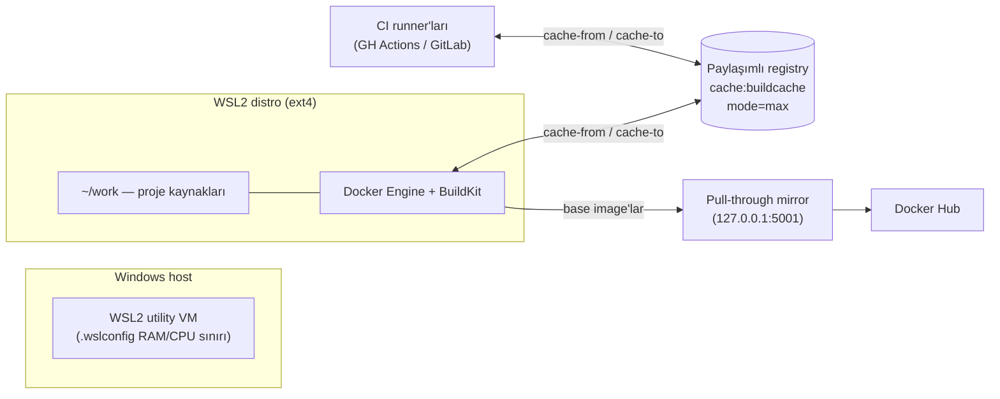

# stoke

> Windows için hafif konteyner kurulumu: Docker Desktop olmadan **WSL2 içinde Docker Engine** + yerel build'ler ile CI build'lerinin ortak kullandığı **paylaşımlı BuildKit katman cache'i**.

English README: [README.md](README.md)

[](LICENSE)
[](https://github.com/kefyusuf/stoke/actions/workflows/ci.yml)
[](https://scorecard.dev/viewer/?uri=github.com/kefyusuf/stoke)

> ⚠️ **Çalıştırmadan önce okuyun.** Bu scriptler sistem düzeyinde değişiklik yapar
> (Windows özellikleri, WSL içi apt/systemd, root sahipli dosyalar). Amaçlanan akış
> oku-sonra-koştur — her scriptin neye dokunduğu: [SECURITY.md](SECURITY.md).
> Güvenlik ağı hazır: her scriptte `--dry-run` var (önizleme, hiçbir şey değiştirmez),
> ilk değişiklikten önce planı gösterip `[y/N]` sorar ve işi bitince
> `setup/teardown.sh` her şeyi geri alır.

## Neden

| Sorun | Bu kit |
|---|---|
| Docker Desktop boşta ~2–3 GB RAM tutar, arka planda CPU'yu uyandırır | WSL2 içinde düz Docker Engine çalıştır — topluluk ölçümlerinde kaynak kullanımı yaklaşık **yarıya iniyor**; `.wslconfig` ise VM'e resmi bir üst sınır koyar |
| `/mnt/c` üzerinden build ~5x yavaş (9P dosya sistemi sınırı) | Kaynakları WSL2 ext4 dosya sisteminde tut — neredeyse native Linux I/O |
| CI her koşuda soğuk cache ile başlar | Yerel ve CI'nin paylaştığı tek BuildKit cache ref'i (`type=registry, mode=max`): **ilk build eden herkese ısıtır** |
| Base image'lar her makinede yeniden indirilir | Opsiyonel pull-through registry mirror Docker Hub'ı yerelde tutar |
| Docker Desktop 250+ çalışan veya 10M$+ ciroya lisans ister | Docker Engine Apache-2.0 — lisans derdi yok |

Tüm iddiaların kaynakları: [docs/evidence.tr.md](docs/evidence.tr.md)

## Kanıt — kaydedilmiş çıktılar

<details>
<summary>Gerçek bir verify.sh koşusunun çıktısı (WSL motoru, 2026-11-04)</summary>

```text
  PASS  warm build: 1308 ms
  PASS  layer cache speedup: 7x (warm < cold)
  PASS  builder A exported cache to the registry (mode=max)
  PASS  builder B (fresh, empty store) hit CACHED layers via --cache-from registry
  PASS  => cross-machine cache reuse (local <-> CI) works on this machine

  ALL CHECKS PASSED - this machine is cache-ready.
```
</details>

<details>
<summary>Üç şablonun tamamı: build edildi ve smoke testi geçti (prod konteynerleri HTTP)</summary>

```text
--- node-ts prod: {"ok":true,"stack":"node-ts","time":"2026-11-04T16:54:16.714Z"}
--- rust  prod:   {"ok":true,"stack":"rust","epoch":1793812091}
--- go    prod:   {"ok":true,"stack":"go","time":"2026-11-04T17:08:23Z"}
```
</details>

## Mimari



Yerel build → cache'i paylaşımlı ref'e yazar. CI o ref'i sıcak cache olarak çeker ve kendi güncellemesini geri yazar. Mirror, base image'ları tüm ekip için tek indirmeye indirger.

## Hızlı Kurulum

Ön koşullar: Windows 10 21H2+ veya Windows 11, yönetici PowerShell, ~10 GB disk.

1. **Windows tarafı** (yönetici PowerShell, repo kökünde):
   ```powershell
   ./setup/setup-wsl.ps1            # WSL2 + Ubuntu kurar, .wslconfig yazar, WSL'ı yeniden başlatır
   ```
   Script çalıştırma politikası engellerse:
   `powershell -ExecutionPolicy Bypass -File setup\setup-wsl.ps1`.
2. **WSL içinde** (distro terminalini aç):
   ```bash
   mkdir -p ~/work && cd ~/work                        # ext4, /mnt/c DEĞİL
   git clone <bu-repo> && cd stoke
   ./setup/setup-engine.sh                             # docker-ce + buildx + compose plugin
   # önce planı gösterir, [y/N] sorar (--dry-run önizleme, --yes soru yok);
   # docker grubunun etkili olması için çık-gir yap (veya `newgrp docker`)
   ```
3. **Opsiyonel paylaşımlı cache registry'si** (yerel, TLS gerektirmez — 127.0.0.0/8 varsayılan olarak insecure):
   ```bash
   docker compose -f cache-stack/docker-compose.registry.yml up -d
   ```
4. **Cache ile build**: tek komutla proje iskeleti (stack şablonu + build sarmalayıcıları + proje-özel `.env`):
   ```bash
   ./setup/init-project.sh rust myapp    # stack'ler: rust | go | node-ts
   cd myapp && ./build.sh                # CACHE_REF zaten .env'de
   ```
   ya da `templates/Dockerfile` + `templates/build.sh`'i elle kopyala.
5. **Çalıştığını kanıtla**:
   ```bash
   ./setup/verify.sh      # araç zincirini kontrol eder, soğuk/cached build süresini ölçer, registry cache döngüsünü test eder
   ```
6. **Sonra çıkmak ister misin?** Kit kendini geri alır:
   ```bash
   ./setup/teardown.sh --dry-run   # geri alma planını önizle, hiçbir şey değişmez
   ./setup/teardown.sh             # konteynerler -> context -> servisler -> grup -> paketler -> repo dosyaları
   ```
   `/var/lib/docker` ve `.wslconfig`'e yalnızca açıkça `--purge-data` /
   `--restore-wslconfig` verirsen dokunur.

CI tarafı için aynı `CACHE_REF` değerini pipeline'a bağla — hazır şablonlar [`ci/`](ci/) klasöründe.

## Günlük kullanım

| Komut | Ne yapar |
|---|---|
| `./setup/doctor.sh` | Tek geçişlik salt-okunur sağlık raporu: daemon, buildx, context, systemd, Desktop CLI gölgesi, cache stack, mirror kaydı, disk |
| `./setup/init-project.sh <stack> <ad>` | Proje iskeleti: stack şablonu + sarmalayıcılar + proje-özel `.env` (`rust \| go \| node-ts`) |
| `./setup/windows-context.ps1` | Motoru Windows araçlarına köprüle (PowerShell CLI, VS Code Docker paneli); `-Undo` geri alır |
| `./setup/verify.sh` | Benchmark: soğuk/cached build + registry cache döngüsü |
| `./setup/protect-distro.sh check` | Desktop paralel çalışırken CLI/soket sahibi kim? |
| `./setup/teardown.sh --dry-run` | Tam kaldırmanın önizlemesi; uygulamak için flag'siz çalıştır |

> **Docker Desktop kalsın mı?** Kaldırmak zorunda değilsin. Kurulu-ama-kapalı veya tam
> paralel ikisi de çalışır — kontrol listesi, port kuralları ve geri dönüş:
> [docs/migration.tr.md](docs/migration.tr.md).

## Repo haritası

| Yol | Amaç |
|---|---|
| `setup/setup-wsl.ps1` | Windows tarafı: WSL2, distro, `.wslconfig` |
| `setup/.wslconfig.template` | Yorumlu RAM/CPU/swap sınırları |
| `setup/setup-engine.sh` | WSL içi Docker Engine + buildx + compose kurulumu |
| `setup/setup-nerdctl.sh` | Opsiyonel daha hafif varyant: containerd + nerdctl |
| `setup/verify.sh` | Smoke test + cache benchmark (ilk ve ikinci build) |
| `setup/doctor.sh` | Günlük salt-okunur sağlık raporu (FAIL/WARN/INFO satırları) |
| `setup/init-project.sh` | Proje iskeletleyici: stack şablonu + sarmalayıcılar + proje-özel `.env` |
| `setup/windows-context.ps1` | Kit motoruna Windows tarafından erişim (loopback TCP + context, `-Undo` dahil) |
| `setup/teardown.sh` | Kit'in her mutasyonunu güvenli sırayla geri alır (veri/config silme kesinlikle opt-in) |
| `cache-stack/` | Yerel cache registry + pull-through mirror (compose) |
| `templates/` | Genel multi-stage Dockerfile + cache uyumlu build sarmalayıcıları |
| `templates/node-ts/` | Çalışan Node/TS örneği: prod + dev target'lar, pnpm store cache mount'ları, compose dev sunucusu |
| `templates/rust/` | Çalışan Rust örneği: dummy-crate deps stage, cargo cache mount'ları, musl statik binary |
| `templates/go/` | Çalışan Go örneği: GOMODCACHE/GOCACHE mount'ları, `scratch` prod imajı |
| `ci/` | GitHub Actions (registry ve gha cache) ve GitLab CI şablonları |
| `tests/` | Scriptlerin guard/dry-run/consent/teardown sözleşmeleri için sıfır-bağımlılık birim testleri (CI'da çalışır) |
| `docs/` | Kanıtlar, derinlemesine rehberler, SSS |

## Dokümantasyon

- [docs/evidence.tr.md](docs/evidence.tr.md) — kaynaklı iddialar tablosu ([EN](docs/evidence.md))
- [docs/setup-wsl2.tr.md](docs/setup-wsl2.tr.md) — WSL2 + Engine manuel kurulum ([EN](docs/setup-wsl2.md))
- [docs/cache-guide.tr.md](docs/cache-guide.tr.md) — BuildKit cache backend'leri, `mode=max`, cache mount'lar ([EN](docs/cache-guide.md))
- [docs/registry-mirror.tr.md](docs/registry-mirror.tr.md) — pull-through mirror kurulumu ve sınırları ([EN](docs/registry-mirror.md))
- [docs/nerdctl-variant.tr.md](docs/nerdctl-variant.tr.md) — containerd + nerdctl alternatif yolu ([EN](docs/nerdctl-variant.md))
- [docs/migration.tr.md](docs/migration.tr.md) — Docker Desktop ile bir arada yaşama: kurulu-ama-kapalı veya tam paralel ([EN](docs/migration.md))
- [docs/faq.tr.md](docs/faq.tr.md) — sorun giderme (VMMEM, izinler, cache ıskalamalar…) ([EN](docs/faq.md))
- [docs/releasing.tr.md](docs/releasing.tr.md) — sürüm çıkarma ritüeli ve artifact attestation'lar ([EN](docs/releasing.md))

## Gereksinimler

- Sanallaştırma açık Windows 10 21H2+ / Windows 11
- Distro + imajlar için ~10 GB boş disk
- Makinen ve CI'nin erişebildiği bir Docker registry (GHCR, GitLab registry veya test için dahili olan)

## Lisans

MIT — bkz. [LICENSE](LICENSE).
