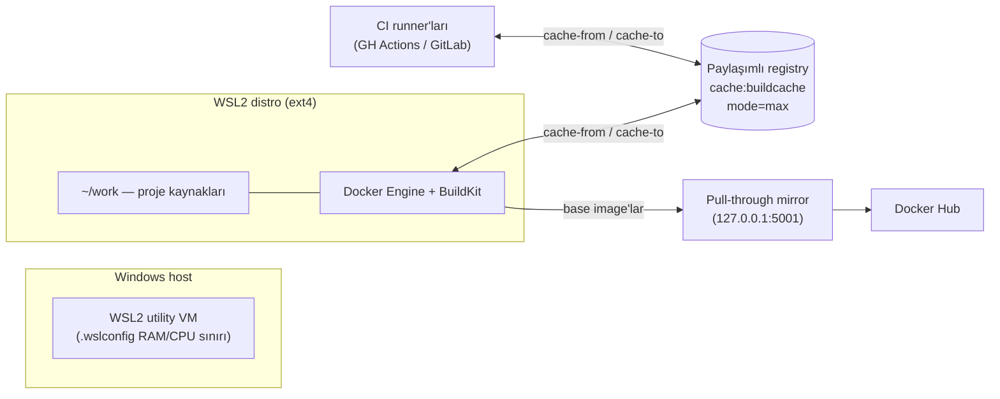

# wsl2-docker-cache-kit

> Windows için hafif konteyner kurulumu: Docker Desktop olmadan **WSL2 içinde Docker Engine** + yerel build'ler ile CI build'lerinin ortak kullandığı **paylaşımlı BuildKit katman cache'i**.

English README: [README.md](README.md)

## Neden

| Sorun | Bu kit |
|---|---|
| Docker Desktop boşta ~2–3 GB RAM tutar, arka planda CPU'yu uyandırır | WSL2 içinde düz Docker Engine çalıştır — topluluk ölçümlerinde kaynak kullanımı yaklaşık **yarıya iniyor**; `.wslconfig` ise VM'e resmi bir üst sınır koyar |
| `/mnt/c` üzerinden build ~5x yavaş (9P dosya sistemi sınırı) | Kaynakları WSL2 ext4 dosya sisteminde tut — neredeyse native Linux I/O |
| CI her koşuda soğuk cache ile başlar | Yerel ve CI'nin paylaştığı tek BuildKit cache ref'i (`type=registry, mode=max`): **ilk build eden herkese ısıtır** |
| Base image'lar her makinede yeniden indirilir | Opsiyonel pull-through registry mirror Docker Hub'ı yerelde tutar |
| Docker Desktop 250+ çalışan veya 10M$+ ciroya lisans ister | Docker Engine Apache-2.0 — lisans derdi yok |

Tüm iddiaların kaynakları: [docs/evidence.tr.md](docs/evidence.tr.md)

## Mimari



Yerel build → cache'i paylaşımlı ref'e yazar. CI o ref'i sıcak cache olarak çeker ve kendi güncellemesini geri yazar. Mirror, base image'ları tüm ekip için tek indirmeye indirger.

## Hızlı Kurulum

Ön koşullar: Windows 10 21H2+ veya Windows 11, yönetici PowerShell, ~10 GB disk.

1. **Windows tarafı** (yönetici PowerShell, repo kökünde):
   ```powershell
   ./setup/setup-wsl.ps1            # WSL2 + Ubuntu kurar, .wslconfig yazar, WSL'ı yeniden başlatır
   ```
   Script çalıştırma politikası engellerse:
   `powershell -ExecutionPolicy Bypass -File setup\setup-wsl.ps1`.
2. **WSL içinde** (distro terminalini aç):
   ```bash
   mkdir -p ~/work && cd ~/work                        # ext4, /mnt/c DEĞİL
   git clone <bu-repo> && cd wsl2-docker-cache-kit
   ./setup/setup-engine.sh                             # docker-ce + buildx + compose plugin
   # docker grubunun etkili olması için çık-gir yap (veya `newgrp docker`)
   ```
3. **Opsiyonel paylaşımlı cache registry'si** (yerel, TLS gerektirmez — 127.0.0.0/8 varsayılan olarak insecure):
   ```bash
   docker compose -f cache-stack/docker-compose.registry.yml up -d
   ```
4. **Cache ile build**: `templates/Dockerfile` ve `templates/build.sh` dosyalarını projene kopyala:
   ```bash
   CACHE_REF=127.0.0.1:5000/myapp:buildcache ./build.sh
   ```
5. **Çalıştığını kanıtla**:
   ```bash
   ./setup/verify.sh      # araç zincirini kontrol eder, soğuk/cached build süresini ölçer, registry cache döngüsünü test eder
   ```

CI tarafı için aynı `CACHE_REF` değerini pipeline'a bağla — hazır şablonlar [`ci/`](ci/) klasöründe.

## Repo haritası

| Yol | Amaç |
|---|---|
| `setup/setup-wsl.ps1` | Windows tarafı: WSL2, distro, `.wslconfig` |
| `setup/.wslconfig.template` | Yorumlu RAM/CPU/swap sınırları |
| `setup/setup-engine.sh` | WSL içi Docker Engine + buildx + compose kurulumu |
| `setup/setup-nerdctl.sh` | Opsiyonel daha hafif varyant: containerd + nerdctl |
| `setup/verify.sh` | Smoke test + cache benchmark (ilk ve ikinci build) |
| `cache-stack/` | Yerel cache registry + pull-through mirror (compose) |
| `templates/` | Genel multi-stage Dockerfile + cache uyumlu build sarmalayıcıları |
| `ci/` | GitHub Actions (registry ve gha cache) ve GitLab CI şablonları |
| `docs/` | Kanıtlar, derinlemesine rehberler, SSS |

## Dokümantasyon

- [docs/evidence.tr.md](docs/evidence.tr.md) — kaynaklı iddialar tablosu ([EN](docs/evidence.md))
- [docs/setup-wsl2.tr.md](docs/setup-wsl2.tr.md) — WSL2 + Engine manuel kurulum ([EN](docs/setup-wsl2.md))
- [docs/cache-guide.tr.md](docs/cache-guide.tr.md) — BuildKit cache backend'leri, `mode=max`, cache mount'lar ([EN](docs/cache-guide.md))
- [docs/registry-mirror.md](docs/registry-mirror.md) — pull-through mirror kurulumu ve sınırları
- [docs/nerdctl-variant.md](docs/nerdctl-variant.md) — containerd + nerdctl alternatif yolu
- [docs/faq.md](docs/faq.md) — sorun giderme (VMMEM, izinler, cache ıskalamalar…)

## Gereksinimler

- Sanallaştırma açık Windows 10 21H2+ / Windows 11
- Distro + imajlar için ~10 GB boş disk
- Makinen ve CI'nin erişebildiği bir Docker registry (GHCR, GitLab registry veya test için dahili olan)

## Lisans

MIT — bkz. [LICENSE](LICENSE).
